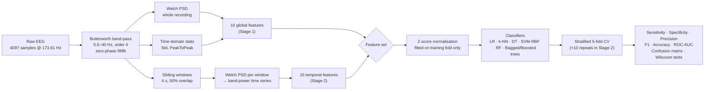
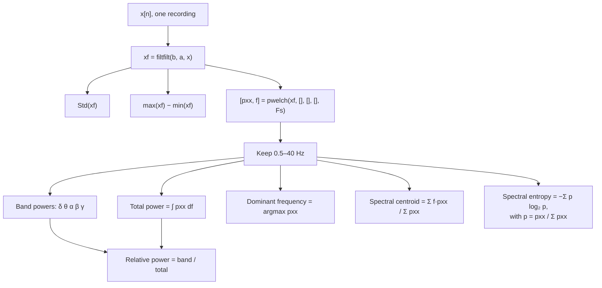
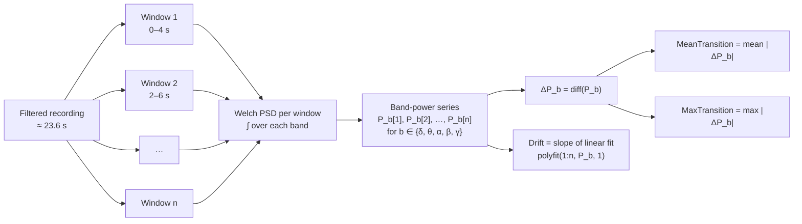
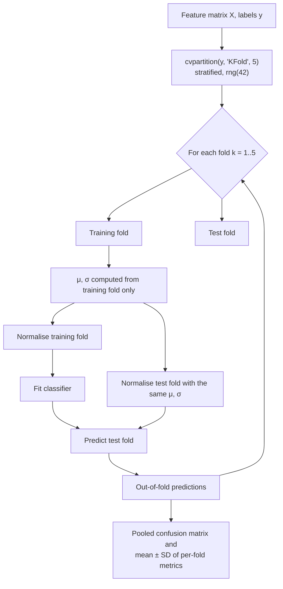
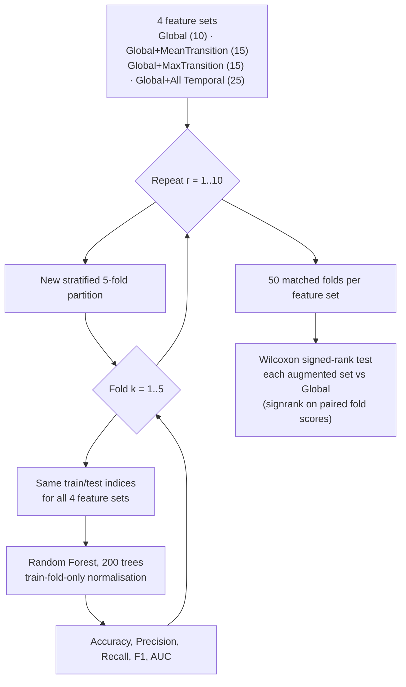
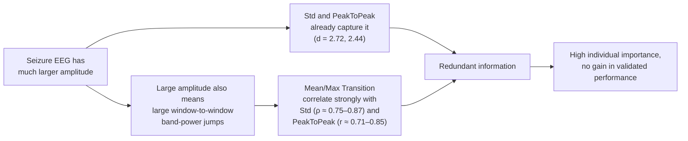
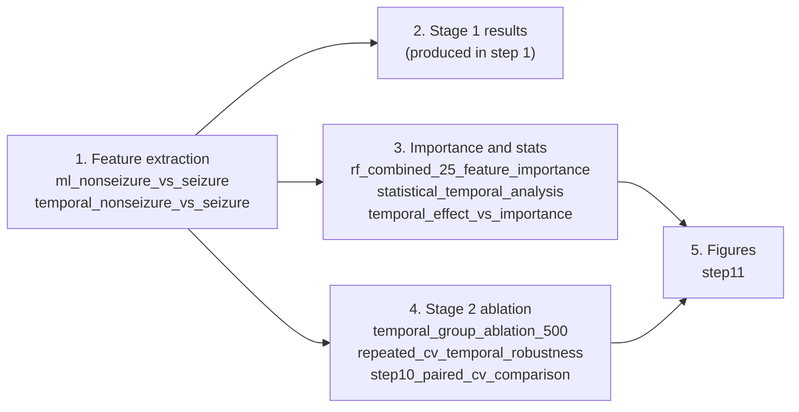

# Automatic EEG-Based Epileptic Seizure Detection

**A DSP + machine-learning pipeline for seizure detection on the University of Bonn EEG dataset.**

Course project for *Digital Signal Processing (ECN15101)*, Department of Electronics and Communication Engineering, Motilal Nehru National Institute of Technology Allahabad. Group 3.

The project has two stages:

| Stage | Question | Answer |
|---|---|---|
| **Stage 1: Global-feature detection** | Can ten interpretable DSP features (amplitude and spectral) separate seizure from non-seizure EEG? | Yes. Random Forest reaches **98.4 % accuracy, 94.0 % sensitivity, 99.5 % specificity, 0.998 ROC-AUC** (500 recordings, stratified 5-fold CV). |
| **Stage 2: Temporal spectral dynamics** | Do features describing how band power changes over time (4 s windows, 50 % overlap) add anything on top of the global features? | No. Over 50 paired repeated-CV folds, no temporal feature set improves accuracy, and two sets slightly but significantly **lower** AUC. |

> **Not a clinical tool.** This is a benchmark study on a clean, pre-segmented public dataset. It has not been validated on clinical recordings. See [Limitations](#limitations).

---

## Table of contents

1. [Repository layout](#repository-layout)
2. [Dataset](#dataset)
3. [System overview](#system-overview)
4. [Signal processing](#signal-processing)
5. [Stage 1: global features](#stage-1-global-features)
6. [Stage 2: temporal spectral-dynamics features](#stage-2-temporal-spectral-dynamics-features)
7. [Evaluation protocol](#evaluation-protocol)
8. [Experiments](#experiments)
9. [Results](#results)
10. [Comparison with the base paper](#comparison-with-the-base-paper)
11. [Script and data flow](#script-and-data-flow)
12. [How to reproduce](#how-to-reproduce)
13. [Project website](#project-website)
14. [Limitations](#limitations)
15. [Future work](#future-work)
16. [Team](#team)
17. [References](#references)

---

## Repository layout

```
eeg-project-repo/
├── README.md                                          ← this file
├── EEG_Seizure_Detection_Project_Report_Formatted copy.pdf   ← full project report (20 pages)
├── results_discussion_conclusion_draft.md             ← draft Results / Discussion / Conclusion text
├── index.html                                         ← single-page project website (the "story")
├── matlab_files/                                      ← 25 MATLAB scripts (whole pipeline)
└── csv_files/                                         ← 30 CSVs: extracted features and result tables
```

The raw Bonn EEG text files are **not** included. See [How to reproduce](#how-to-reproduce).

---

## Dataset

The [University of Bonn EEG dataset](https://www.upf.edu/web/ntsa/downloads) (Andrzejak et al., 2001) has five sets of 100 single-channel segments each. Every segment has **4097 samples at 173.61 Hz (about 23.6 s)**.

| Set | State | Recordings | Label in Stage 1 |
|---|---|---|---|
| Z | Healthy volunteer, eyes open | 100 | Non-seizure (0) |
| O | Healthy volunteer, eyes closed | 100 | Non-seizure (0) |
| N | Interictal (seizure-free interval, hippocampal formation opposite the focus) | 100 | Non-seizure (0) |
| F | Interictal (seizure-free interval, epileptogenic zone) | 100 | Non-seizure (0) |
| S | Ictal (during a seizure) | 100 | **Seizure (1)** |
| **Total** | | **500** | 400 : 100 (4 : 1 imbalance) |

Because the seizure class is the minority, all headline metrics are reported for the **seizure class as the positive class**.

---

## System overview



---

## Signal processing

| Parameter | Value | Purpose |
|---|---|---|
| Sampling frequency | 173.61 Hz (Nyquist 86.8 Hz) | Native Bonn rate |
| Band-pass filter | Butterworth, `butter(4, [0.5 40]/(Fs/2), 'bandpass')`, which gives an 8th-order transfer function | Removes baseline drift and high-frequency noise |
| Filtering mode | `filtfilt` (forward + backward) | Zero phase distortion, so feature timing is preserved |
| Notch filter | Not used | No 50 Hz notch was applied |
| Spectral estimate | `pwelch(x, [], [], [], Fs)`, MATLAB defaults (nfft = 1024 for 4097 samples) | Lower-variance PSD than a single periodogram |
| Band integration | `trapz` over the PSD within each band | Band power |
| Temporal window (Stage 2) | 4 s (≈ 694 samples), 50 % overlap | Tracks spectral change over time |

**EEG bands**

| Band | Range |
|---|---|
| Delta | 0.5–4 Hz |
| Theta | 4–8 Hz |
| Alpha | 8–13 Hz |
| Beta | 13–30 Hz |
| Gamma | 30–40 Hz |



Implementation: [`matlab_files/extract_features.m`](matlab_files/extract_features.m) (`features = extract_features(filename, Fs)`).

---

## Stage 1: global features

Ten features are computed per recording.

| # | Feature | Description |
|---|---|---|
| 1 | `Std` | Standard deviation of the filtered signal |
| 2 | `PeakToPeak` | Maximum minus minimum amplitude |
| 3 | `RelativeDelta` | Delta-band share of total PSD power |
| 4 | `RelativeTheta` | Theta-band share of total PSD power |
| 5 | `RelativeAlpha` | Alpha-band share of total PSD power |
| 6 | `RelativeBeta` | Beta-band share of total PSD power |
| 7 | `RelativeGamma` | Gamma-band share of total PSD power |
| 8 | `DominantFrequency` | Frequency of the largest PSD peak |
| 9 | `SpectralCentroid` | PSD-weighted mean frequency |
| 10 | `SpectralEntropy` | How evenly power is spread across frequencies |

**Why relative band power?** A preliminary run (`load_visualize.m`) used Mean, Std, Variance, RMS, PeakToPeak and *absolute* band powers. Variance and absolute band power were dominated by large seizure outliers, since seizure traces swing roughly ±1500 units against about ±100 for non-seizure traces. The final pipeline therefore uses scale-free relative band powers.

**Classifiers compared.** All use MATLAB defaults except the ensemble sizes. No hyperparameter tuning was done.

| Classifier | MATLAB call / setting |
|---|---|
| Logistic Regression | `fitclinear` / `fitcecoc` (defaults) |
| k-NN | `fitcknn` (defaults) |
| Decision Tree | `fitctree` (defaults) |
| SVM-RBF | `fitcsvm` / `fitcecoc`, RBF kernel, kernel scale 1 |
| Random Forest | `TreeBagger`, 200 trees (100 in some scripts) |
| Bagged Trees | `fitcensemble`, `Method='Bag'`, 100 learners (Exp. B, D) |
| Gradient Boosting | `fitcensemble`, 100 learning cycles (Exp. A, C) |

---

## Stage 2: temporal spectral-dynamics features

Each filtered recording is cut into 4 s windows with 50 % overlap. Band power is computed in every window, which gives one **band-power time series per band**. Three statistics summarise each series:



| Bands | Features per band | Total |
|---|---|---|
| Delta, Theta, Alpha, Beta, Gamma | `MeanTransition`, `MaxTransition`, `Drift` | **15** |

Column naming: `<Band>_<Statistic>`, e.g. `Theta_MeanTransition`.

An exploratory version ([`temporal_features.m`](matlab_files/temporal_features.m), Z vs S only) also computed per-band `Mean` and `TemporalStd`, giving 25 features. It checked how strongly each temporal feature correlates with the global features (`temporal_feature_redundancy.csv`). The final Stage 2 set keeps only the 15 transition and drift features.

---

## Evaluation protocol

### Leakage-free cross-validation (every experiment)



Every recording is tested exactly once, and test-fold statistics never influence normalisation.

### Paired repeated CV (Stage 2 ablation, `step10_paired_cv_comparison.m`)



Because all four feature sets see identical folds, the differences are paired. A temporal set "helps" only if it beats Global consistently on the same folds.

### Metrics

| Metric | Definition | Meaning |
|---|---|---|
| Sensitivity (recall) | TP / (TP + FN) | Fraction of true seizures detected. A low value means missed seizures. |
| Specificity | TN / (TN + FP) | Fraction of non-seizure recordings correctly rejected. A low value means false alarms. |
| Precision | TP / (TP + FP) | Fraction of seizure predictions that are correct |
| F1 | 2PR / (P + R) | Harmonic mean of precision and recall |
| Accuracy | (TP + TN) / N | Overall correctness, which can mislead under 4 : 1 imbalance |
| ROC-AUC | Area under the ROC curve | Probability that a seizure scores above a non-seizure |

### Statistical tests

| Test | Used for | Script |
|---|---|---|
| Wilcoxon rank-sum (`ranksum`) | Per-feature class difference (two groups) | `statistical_feature_analysis.m`, `statistical_temporal_analysis.m` |
| Kruskal–Wallis | Per-feature difference across F / N / O / S | `four_class_statistical_analysis.m` |
| Benjamini–Hochberg FDR | Multiple-comparison correction (implemented by hand, so the Bioinformatics Toolbox is not needed) | same scripts |
| Cohen's d | Effect size | same scripts |
| Wilcoxon signed-rank (`signrank`) | Paired fold-level comparison of feature sets | `step10_paired_cv_comparison.m` |

---

## Experiments

| Exp | Task | Recordings | Role | Main scripts |
|---|---|---|---|---|
| **A** | Z vs S (healthy vs seizure) | 200 | Preliminary, easy case | `load_visualize.m`, `ml_model_comparison.m` |
| **B** | Z + O + F + N vs S (non-seizure vs seizure) | 500 | **Main Stage 1 and Stage 2 experiment** | `ml_nonseizure_vs_seizure.m`, `temporal_nonseizure_vs_seizure.m`, `step10_paired_cv_comparison.m` |
| **C** | F + N vs S (interictal vs ictal) | 300 | Extended analysis | `build_interictal_ictal_features.m`, `ml_interictal_ictal_comparison.m` |
| **D** | F / N / O / S (four-class) | 400 | Extended analysis | `build_F_N_O_S_features.m`, `ml_F_N_O_S_4class.m` |

---

## Results

All numbers below come directly from the CSVs in [`csv_files/`](csv_files/).

### Stage 1, Experiment B: non-seizure vs seizure (500 recordings)

Pooled out-of-fold predictions, seizure = positive class (from the report, recomputed from `nonseizure_vs_seizure_oof_predictions.csv`):

| Model | Accuracy | Sensitivity | Specificity | Precision | F1 | Mean AUC |
|---|---|---|---|---|---|---|
| Logistic Regression | 96.4 % | 85.0 % | 99.25 % | 96.6 % | 90.4 % | 0.990 |
| k-NN | 97.8 % | 91.0 % | 99.5 % | 97.9 % | 94.3 % | 0.969 |
| Decision Tree | 98.0 % | **96.0 %** | 98.5 % | 94.1 % | 95.1 % | 0.974 |
| SVM-RBF | 97.4 % | 89.0 % | 99.5 % | 97.8 % | 93.2 % | 0.998 |
| **Random Forest** | **98.4 %** | 94.0 % | **99.5 %** | **97.9 %** | **95.9 %** | **0.998** |
| Bagged Trees | 98.4 % | 94.0 % | 99.5 % | 97.9 % | 95.9 % | 0.999 |

Random Forest and Bagged Trees produce identical predictions because both are bagging ensembles of trees.

> `nonseizure_vs_seizure_results.csv` stores **macro-averaged** precision/recall/F1 per fold (e.g. RF recall 96.75 %, F1 97.43 %). Those are not the seizure-class sensitivity. The table above uses seizure-class metrics.

**Random Forest confusion matrix (500 recordings):**

|  | Predicted non-seizure | Predicted seizure |
|---|---|---|
| **Actual non-seizure (400)** | 398 (TN) | 2 (FP) |
| **Actual seizure (100)** | 6 (FN) | 94 (TP) |

Specificity is above 98 % for every model, so false alarms are rare. The models differ mainly in how many seizures they miss: logistic regression misses 15 and the decision tree misses 4.

### Experiment A: Z vs S (200 recordings), `ml_model_comparison.csv`

| Model | Accuracy | F1 | AUC |
|---|---|---|---|
| Logistic Regression | 98.5 % | 98.5 % | 0.9985 |
| k-NN | 95.0 % | 94.9 % | 0.9895 |
| Decision Tree | 100 % | 100 % | 1.000 |
| SVM-RBF | 97.0 % | 96.9 % | 0.9975 |
| Random Forest | 100 % | 100 % | 1.000 |
| Gradient Boosting | 100 % | 100 % | 1.000 |

This case is too easy to use as the headline result: healthy EEG and ictal EEG differ massively in amplitude.

### Experiment C: interictal (F + N) vs ictal (S), 300 recordings, `interictal_ictal_model_comparison.csv`

| Model | Accuracy | F1 | AUC |
|---|---|---|---|
| Logistic Regression | 96.0 % | 94.1 % | 0.9928 |
| k-NN | 97.0 % | 95.3 % | 0.9905 |
| Decision Tree | 97.3 % | 96.0 % | 0.9833 |
| SVM-RBF | 95.7 % | 93.9 % | 0.9659 |
| **Random Forest** | **98.0 %** | **97.0 %** | **0.9980** |
| Gradient Boosting | 97.0 % | 95.5 % | 0.9880 |

Leave-one-feature-out ablation on this task (`feature_ablation_rf.csv`): the full 10-feature RF reaches 98.0 % / AUC 0.998.

### Experiment D: four-class F / N / O / S (400 recordings), `F_N_O_S_4class_results.csv`

| Model | Accuracy | Macro F1 |
|---|---|---|
| Logistic Regression | 81.25 % | 80.3 % |
| k-NN | 84.25 % | 84.1 % |
| Decision Tree | 81.50 % | 81.3 % |
| **SVM-RBF** | **86.75 %** | **86.5 %** |
| Random Forest | 85.75 % | 85.6 % |
| Bagged Trees | 85.00 % | 84.9 % |

SVM-RBF separates O (99/100) and S (94/100) well. Most errors fall between the two interictal sets: **29 F → N and 11 N → F**. That is expected, because F and N are both seizure-free intervals and are spectrally similar.

### Stage 2: does temporal information help?

**Effect sizes** (`statistical_temporal_analysis.csv`, `statistical_feature_analysis.csv`). 14 of 15 temporal features are significant after FDR correction. The exception is `Alpha_Drift` (FDR p = 0.0599).

| Feature | Type | Cohen's d |
|---|---|---|
| Std | Global | 2.72 |
| PeakToPeak | Global | 2.44 |
| Theta_MeanTransition | Temporal | 2.30 |
| Alpha_MaxTransition | Temporal | 2.05 |
| Theta_MaxTransition | Temporal | 2.02 |

Drift features have smaller effects (|d| ≈ 0.32–1.0).

**Paired repeated CV: Random Forest, 10 × 5 folds, 500 recordings** (`step10_paired_cv_summary.csv`)

| Feature set | # features | Accuracy | F1 | AUC |
|---|---|---|---|---|
| **Global** | 10 | 98.34 % ± 1.15 | 95.83 % ± 2.91 | **0.99863** ± 0.00208 |
| Global + MeanTransition | 15 | 98.50 % ± 0.99 | 96.21 % ± 2.52 | 0.99845 ± 0.00260 |
| Global + MaxTransition | 15 | 98.18 % ± 1.19 | 95.40 % ± 3.04 | 0.99797 ± 0.00277 |
| Global + All Temporal | 25 | 98.26 % ± 1.23 | 95.61 % ± 3.08 | 0.99733 ± 0.00435 |

**Wilcoxon signed-rank tests vs Global** (`step10_paired_cv_comparison.csv`)

| Comparison | ΔAccuracy (pp) | p | ΔF1 (pp) | p | ΔAUC | p |
|---|---|---|---|---|---|---|
| + MeanTransition | +0.16 | 0.074 | +0.39 | 0.236 | −0.00018 | 0.241 |
| + MaxTransition | −0.16 | 0.074 | −0.43 | **0.013** | −0.00066 | **4.3 × 10⁻⁵** |
| + All Temporal | −0.08 | 0.463 | −0.22 | 0.148 | −0.00130 | **2.1 × 10⁻⁴** |

**Conclusion:** none of the temporal sets improves accuracy or F1. MaxTransition and All Temporal cause small but statistically detectable **drops** in AUC.

The same pattern appears in the single-run group ablation with RF and Bagged Trees, which also tests Global + Drift (`temporal_group_ablation_500_results.csv`). Every set falls within 98.2–98.6 % accuracy, inside one standard deviation of Global.

### Why the temporal features did not help



- Transition features mostly re-encode **amplitude and energy**, which the global features already provide. Gamma transition features reach a maximum |correlation| with a global feature of about 0.93 (`temporal_feature_redundancy.csv`).
- In the combined 25-feature Random Forest (`rf_combined_25_feature_importance.csv`, OOB permutation importance), the top 3 are **Std (0.83), Theta_MeanTransition (0.80), Theta_MaxTransition (0.59)**. Individually informative features need not improve the ensemble when their information overlaps.
- Adding 15 noisier dimensions increases variance for a finite sample of 500 recordings, which may explain the small AUC drops.

This is an interpretation, not a causal claim.

### Exploratory LSTM (reported separately)

The report also describes a separate Python/PyTorch experiment: a 2-layer LSTM (hidden size 64, dropout 0.35, Adam, learning rate 1e-3, 100 epochs) on raw F vs S signals with a single 80/20 split. It logged 95 % test accuracy at epoch 40. The test set had only 40 samples and was monitored every epoch, so this figure is optimistic. It is **not** comparable with the MATLAB results, and its code is not in this repository.

### Summary of findings

| Finding | Evidence | Interpretation |
|---|---|---|
| Stage 1 detects seizures well | 98.4 % acc, 94.0 % sens, 99.5 % spec (RF) | Few false alarms; some seizures are still missed |
| Amplitude features dominate | Std d = 2.72, PeakToPeak d = 2.44 | Seizures in this dataset separate strongly by amplitude |
| Temporal features add no clear benefit | 98.26 % vs 98.34 %; lower AUC for MaxTransition and All Temporal | Transition features duplicate amplitude information |
| F vs N is the hardest pair | 29 F → N, 11 N → F | Both are interictal and spectrally similar |
| Easy cases overstate performance | Exp A reaches 100 % | Z vs S should not be the headline result |

---

## Comparison with the base paper

The base paper [1] uses the same dataset and task but a different pipeline: a Gaussian-based Stockwell Transform for sub-band decomposition, five handcrafted feature types, and a Random Forest evaluated on a percentage split.

| Aspect | Base paper [1] | Stage 1 (this project) | Stage 2 (this project) |
|---|---|---|---|
| Pre-processing | Gaussian-based Stockwell Transform | Butterworth 0.5–40 Hz + Welch PSD | Butterworth + windowed band power |
| Features | Fluctuation index, relative amplitude, holoentropy, log band power, Hermite-based delta AMS | 10 global DSP features | 10 global + 15 temporal |
| Classifier | Random Forest | Random Forest (best of six) | Random Forest, feature-set ablation |
| Validation | Percentage split (50 % / 90 % training) | Stratified 5-fold CV | 10 × 5 paired repeated CV |
| Headline | 96.4 % acc, **97.0 % sens**, 96.4 % spec | **98.4 % acc**, 94.0 % sens, **99.5 % spec** | 98.26 % (All Temporal) vs 98.34 % (Global) |

Stage 1 is about 2.0 pp higher in accuracy and 3.1 pp higher in specificity. The base paper is about 3.0 pp higher in sensitivity, so our model misses more seizures. **This is not a controlled head-to-head comparison**: the validation protocols, preprocessing and features differ.

---

## Script and data flow

Every script reads and writes files in the **current MATLAB folder**. The arrows below show which CSV each script produces and which scripts consume it.

```mermaid
flowchart TD
    subgraph RAW["Raw Bonn data folders"]
        Z["non_seizure/ (Z)"]
        O["O/"]
        F["F/"]
        N["N/"]
        S["seizure/ (S)"]
    end

    EF[["extract_features.m<br/>(function)"]]

    %% Experiment A
    Z & S --> LV["load_visualize.m"]
    LV --> c_eeg[("eeg_features.csv")]
    LV --> c_mc[("model_comparison.csv")]
    c_eeg --> MMC["ml_model_comparison.m"] --> c_mmc[("ml_model_comparison.csv")]
    Z & S --> TFE["temporal_features.m"]
    c_eeg --> TFE
    TFE --> c_tf[("eeg_temporal_features.csv<br/>temporal_feature_redundancy.csv<br/>temporal_feature_effect_sizes.csv")]
    Z & S --> TA["temporal_analysis.m<br/>(band-power trajectory plots)"]

    %% Experiment B
    Z & O & F & N & S --> MNS["ml_nonseizure_vs_seizure.m"]
    EF -.-> MNS
    MNS --> c_nsf[("nonseizure_vs_seizure_features.csv")]
    MNS --> c_nsr[("nonseizure_vs_seizure_results.csv<br/>nonseizure_vs_seizure_oof_predictions.csv")]
    Z & O & F & N & S --> TNS["temporal_nonseizure_vs_seizure.m"]
    TNS --> c_tns[("temporal_nonseizure_vs_seizure_features.csv")]

    c_nsf & c_tns --> RCI["rf_combined_25_feature_importance.m"] --> c_rci[("rf_combined_25_feature_importance.csv")]
    c_tns & c_rci --> STA["statistical_temporal_analysis.m"] --> c_sta[("statistical_temporal_analysis.csv")]
    c_sta --> TEI["temporal_effect_vs_importance.m"] --> c_tei[("temporal_effect_vs_importance.csv")]
    c_nsf & c_tns --> CGT["compare_global_temporal_combined_500.m"] --> c_cgt[("global_temporal_combined_500_results.csv")]
    c_nsf & c_tns --> TGA["temporal_group_ablation_500.m"] --> c_tga[("temporal_group_ablation_500_results.csv")]
    c_nsf & c_tns --> RCV["repeated_cv_temporal_robustness.m"] --> c_rcv[("repeated_cv_temporal_robustness.csv")]
    c_nsf & c_tns --> S10["step10_paired_cv_comparison.m"] --> c_s10[("step10_paired_cv_summary.csv<br/>step10_paired_cv_comparison.csv<br/>step10_paired_cv_fold_results.csv")]
    c_nsf & c_tns & c_s10 & c_rci --> S11["step11.m / step11_figures.m"] --> FIGS["Report figures (PNG)"]

    %% Experiment C
    F & N & S --> BII["build_interictal_ictal_features.m"]
    EF -.-> BII
    BII --> c_ii[("interictal_vs_ictal_features.csv")]
    c_ii --> MIC["ml_interictal_ictal_comparison.m"] --> c_mic[("interictal_ictal_model_comparison.csv")]
    c_ii --> RFI["rf_feature_importance.m"] --> c_rfi[("rf_feature_importance.csv")]
    c_ii --> FAB["feature_ablation_rf.m"] --> c_fab[("feature_ablation_rf.csv")]
    c_ii & c_rfi --> SFA["statistical_feature_analysis.m"] --> c_sfa[("statistical_feature_analysis.csv")]
    F & N & S --> TII["temporal_interictal_ictal_features.m"] --> c_tii[("temporal_interictal_ictal_features.csv")]

    %% Experiment D
    F & N & O & S --> BFN["build_F_N_O_S_features.m"]
    EF -.-> BFN
    BFN --> c_fnos[("f_n_o_s_features.csv")]
    c_fnos --> M4["ml_F_N_O_S_4class.m"] --> c_m4[("F_N_O_S_4class_results.csv<br/>F_N_O_S_4class_oof_predictions.csv")]
    c_fnos --> FCS["four_class_statistical_analysis.m"] --> c_fcs[("f_n_o_s_statistical_analysis.csv")]
```



### Script reference

| Script | Purpose |
|---|---|
| `extract_features.m` | **Function.** Filter, Welch PSD, return the 10 global features for one file |
| `load_visualize.m` | Exp A walkthrough: load and plot signals, filter, PSD, features, SVM / LR / RF with CV and confusion matrices |
| `ml_model_comparison.m` | Exp A: six-model comparison (incl. Gradient Boosting) on `eeg_features.csv` |
| `temporal_analysis.m` | Plots window-wise band-power trajectories for Z001 vs S001 |
| `temporal_features.m` | Exp A: exploratory 25 temporal features, redundancy vs global features, effect sizes |
| `ml_nonseizure_vs_seizure.m` | **Exp B main Stage 1**: extract 10 features for 500 recordings, six models, OOF predictions |
| `temporal_nonseizure_vs_seizure.m` | **Exp B Stage 2**: extract the 15 temporal features for 500 recordings |
| `compare_global_temporal_combined_500.m` | Global vs Temporal vs Combined across six models |
| `temporal_group_ablation_500.m` | Global + {MeanTransition, MaxTransition, Drift, All} with RF and Bagged Trees |
| `repeated_cv_temporal_robustness.m` | Repeated-CV robustness check of the temporal sets |
| `step10_paired_cv_comparison.m` | **Final Stage 2 test**: 10 × 5 paired CV and Wilcoxon signed-rank tests |
| `rf_combined_25_feature_importance.m` | OOB permutation importance for all 25 features |
| `statistical_temporal_analysis.m` | Rank-sum, FDR, Cohen's d for temporal features, joined with RF importance |
| `temporal_effect_vs_importance.m` | Correlation and scatter of effect size vs RF importance |
| `build_interictal_ictal_features.m` | Exp C feature table (F + N vs S) |
| `ml_interictal_ictal_comparison.m` | Exp C six-model comparison |
| `rf_feature_importance.m` | Exp C RF importance (200 trees) |
| `feature_ablation_rf.m` | Exp C leave-one-feature-out RF ablation |
| `statistical_feature_analysis.m` | Exp C rank-sum, FDR, Cohen's d for global features |
| `temporal_interictal_ictal_features.m` | Exp C temporal features |
| `build_F_N_O_S_features.m` | Exp D feature table |
| `ml_F_N_O_S_4class.m` | Exp D four-class comparison (macro metrics, OOF predictions) |
| `four_class_statistical_analysis.m` | Exp D Kruskal–Wallis + FDR, boxplots |
| `step11.m`, `step11_figures.m` | Final report figures (signals, distributions, CV comparison, importance, robustness) |

### CSV reference

| CSV | Contents |
|---|---|
| `eeg_features.csv` | Exp A: 200 × 10 global features + `Class` |
| `eeg_temporal_features.csv` | Exp A: 200 × 25 exploratory temporal features |
| `nonseizure_vs_seizure_features.csv` | Exp B: 500 × 10 global features + `Group` (Z/O/F/N/S) + `Class` |
| `temporal_nonseizure_vs_seizure_features.csv` | Exp B: 500 × 15 temporal features + `Label` + `ID` |
| `interictal_vs_ictal_features.csv` | Exp C: 300 × 10 global features |
| `temporal_interictal_ictal_features.csv` | Exp C: 300 × 15 temporal features |
| `f_n_o_s_features.csv` | Exp D: 400 × 10 global features + `Group` |
| `*_results.csv`, `*_comparison.csv` | Mean ± SD metrics per model or feature set |
| `*_oof_predictions.csv` | Out-of-fold predicted label for every recording and model |
| `step10_paired_cv_fold_results.csv` | All 50 folds × 4 feature sets × 5 metrics |
| `*statistical*.csv`, `*effect*.csv` | Group statistics, p-values, FDR, Cohen's d |
| `*importance*.csv` | Random Forest feature importances |
| `global_temporal_combined_comparison.csv` | Earlier Global / Temporal / Combined comparison (its Global rows match the 300-recording Exp C run) |

---

## How to reproduce

### Requirements

- MATLAB (R2021a or newer recommended)
- **Signal Processing Toolbox** (`butter`, `filtfilt`, `pwelch`)
- **Statistics and Machine Learning Toolbox** (`fitc*`, `TreeBagger`, `cvpartition`, `ranksum`, `signrank`, `kruskalwallis`)

### 1. Get the data

Download the five Bonn sets (Z, O, N, F, S) and arrange them like this inside one working folder:

```
work/
├── non_seizure/   Z001.txt … Z100.txt
├── O/             O001.txt … O100.txt
├── F/             F001.txt … F100.txt
├── N/             N001.TXT … N100.TXT
└── seizure/       S001.txt … S100.txt
```

The scripts accept both `.txt` and `.TXT`.

### 2. Put scripts and CSVs on the path

The scripts use relative file names, so run them from the folder that holds the data:

```matlab
cd work
addpath('path/to/eeg-project-repo/matlab_files')
% To skip feature extraction and re-run only the analysis,
% copy the CSVs into the working folder:
copyfile('path/to/eeg-project-repo/csv_files/*.csv', '.')
```

### 3. Run order



```matlab
% Stage 1 (Experiment B)
ml_nonseizure_vs_seizure
% Stage 2 features
temporal_nonseizure_vs_seizure
% Importance and statistics
rf_combined_25_feature_importance
statistical_temporal_analysis
temporal_effect_vs_importance
% Stage 2 ablation
temporal_group_ablation_500
repeated_cv_temporal_robustness
step10_paired_cv_comparison
% Figures
step11
```

Optional extended analyses: `build_interictal_ictal_features` → `ml_interictal_ictal_comparison`, `rf_feature_importance`, `feature_ablation_rf`, `statistical_feature_analysis` (Exp C); `build_F_N_O_S_features` → `ml_F_N_O_S_4class`, `four_class_statistical_analysis` (Exp D).

All scripts call `rng(42)`, and the repeated-CV scripts reseed per repeat, so results are reproducible on the same MATLAB version.

---

## Project website

[`index.html`](index.html) is a self-contained single-page write-up of the project: the story, the pipeline, which classifier wins, whether temporal dynamics help, what it means, and the limitations. Open it directly in a browser, or publish it with GitHub Pages:

1. Push the repo to GitHub.
2. **Settings → Pages →** deploy from the branch that contains `index.html`.
3. The site is served at `https://<username>.github.io/<repo>/`.

---

## Limitations

- **Dataset.** Bonn recordings are clean, pre-segmented, single-channel and from a small number of subjects. Seizure and non-seizure segments come from different subjects and conditions, which makes them more separable than in real clinical data. Results may not transfer.
- **No subject-wise split.** Subject-level independence between train and test folds is not verified. Amplitude alone separates the classes strongly here.
- **Paired tests are exploratory.** The 50 folds come from 10 repeats over the same 500 recordings, so they are not independent observations. Treat the p-values as evidence of a consistent direction, not as rigorous inference with n = 50.
- **No external validation.** All evaluation is cross-validation within one dataset.
- **No hyperparameter tuning** and **no 50 Hz notch filter**.
- **Class imbalance (4 : 1)** is handled by reporting seizure-class metrics, not by resampling or class weights. It affects every feature set equally, so the paired comparison is unaffected.
- The Stage 2 conclusion applies **only to the temporal descriptors defined here**.

## Future work

- Patient-wise (subject-independent) validation
- Real-time, windowed detection on continuous multi-channel EEG (e.g. CHB-MIT)
- Tuned classifiers and deep models evaluated on a common split
- Other temporal descriptors (e.g. non-linear or connectivity measures) that are less correlated with amplitude

---

## Team

| Member | Roll no. | Contribution |
|---|---|---|
| Lewin Mariya | 20244508 | System architecture, model integration, data preparation |
| Lokesh Kumar | 20244100 | DSP pipeline (filtering, Welch PSD, feature extraction), ML model architecture |
| Manavi Singh | 20244101 | Dataset characterisation, experimental evaluation, performance analysis |
| Kumar Ujjwal | 20244099 | Literature review, base-paper analysis, report documentation |

Full details are in [`EEG_Seizure_Detection_Project_Report_Formatted copy.pdf`](EEG_Seizure_Detection_Project_Report_Formatted%20copy.pdf).

## References

1. Base paper on Gaussian-Stockwell / Hermite-feature epileptic seizure detection, *Results in Engineering*, 2024.
2. R. G. Andrzejak, K. Lehnertz, F. Mormann, C. Rieke, P. David, C. E. Elger, "Indications of nonlinear deterministic and finite-dimensional structures in time series of brain electrical activity," *Physical Review E*, vol. 64, 061907, 2001.
3. Shoka et al., 2023.
4. Tzallas et al., 2009.
